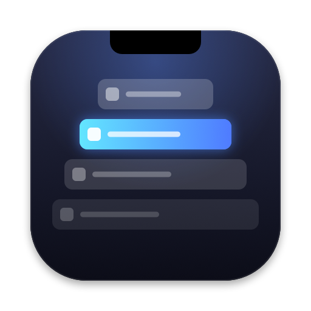

<p align="center">
  
</p>

<h1 align="center">Fold</h1>

<p align="center"><strong>Your MacBook's notch, turned into a window switcher.</strong></p>

Rest the cursor on the notch for a moment and Fold opens a dimmed, blurred overlay listing every open window. Hover a window to see a large live preview, then click it to jump there.

Fold lives in the menu bar and has no Dock icon. It makes no network requests: the window list, thumbnails and switching all stay on your Mac.

## Features

- **Notch trigger.** Hold the cursor on the notch for about 180 ms to open the switcher. Moving past the notch quickly does nothing.
- **Front-to-back window list.** Windows are listed in their current stacking order, so the one you used last is at the top.
- **Live previews.** The highlighted window gets a large thumbnail beside the list.
- **Keyboard support.** Use `↑` `↓` to move the highlight, `Return` to switch, and `Esc` to close.
- **Gets out of the way.** The overlay closes when you click empty space, move the pointer away, or press `Esc`.
- **Works without a notch.** On a Mac with no notch, the trigger is a thin strip at the top center of the main display.
- **Launch at Login.** Turn it on from the menu bar menu.

## Requirements

- macOS 14 Sonoma or later
- Xcode 15.3 or later, or the matching command line tools (for building)
- Screen Recording permission (see below)

## Install

Fold isn't distributed as a download yet, so you build it yourself.

```sh
git clone git@github.com:c4bae/fold.git
cd fold

# One time: create a local code-signing certificate (asks for your keychain password)
scripts/create-dev-cert.sh

# Build build/Fold.app and launch it
scripts/build.sh --run
```

To keep it around, move `build/Fold.app` into `/Applications`.

### Why a local certificate?

macOS ties the Screen Recording permission to the app's code signature. An unsigned build counts as a new app on every rebuild, so you would have to grant permission again each time. `create-dev-cert.sh` creates a self-signed certificate named **Fold Dev** that:

- can only sign code (critical `codeSigning` extended key usage, `CA:FALSE`),
- is trusted only for code signing, and
- lives only in your login keychain. Its temporary files are deleted as soon as the script finishes.

## Permissions

Fold needs **Screen Recording** permission to read window titles and capture previews. On first launch, a welcome window walks you through granting it:

1. Click **Open System Settings** and turn on Fold under *Privacy & Security → Screen & System Audio Recording*.
2. Click **Relaunch Fold**.

You can reopen this guide any time from the menu bar menu (**Welcome Guide…**).

## Usage

| Action | How |
| --- | --- |
| Open the switcher | Rest the cursor on the notch, or choose **Open Fold** from the menu bar menu |
| Preview a window | Hover it, or use `↑` / `↓` |
| Switch to it | Click it, or press `Return` |
| Close the switcher | `Esc`, click empty space, or move the pointer away |

## Limitations

- Only windows on the current Space are listed. Minimized windows are not shown.
- Switching activates the window's app. If that app has several windows, macOS decides which one comes to the front.
- On recent macOS versions, the system may occasionally ask you to confirm Screen Recording access again.

## Development

```sh
scripts/build.sh            # release build into build/Fold.app
scripts/build.sh --debug    # debug build
scripts/build.sh --run      # build, quit any running Fold, and relaunch
swift test                  # unit tests
swift scripts/make-icon.swift .   # regenerate Resources/AppIcon.icns and docs/icon.png
```

This is a Swift package with no Xcode project. The app bundle is put together by `scripts/build.sh`.

```
Sources/Fold/
├── FoldApp.swift          # menu bar extra and app delegate
├── AppCoordinator.swift   # connects the trigger, overlay, model and switching
├── Trigger/               # notch geometry and the hover trigger
├── Overlay/               # overlay panel, keyboard handling, pointer dismissal
├── Windows/               # window list (ScreenCaptureKit) and thumbnails
├── Switching/             # WindowSwitcher protocol and app activation
├── Permissions/           # Screen Recording checks and the welcome window
└── UI/                    # SwiftUI views and the switcher model
```

All switching goes through the `WindowSwitcher` protocol, so a more precise approach (for example, raising a specific window through the Accessibility API) can replace it without changes elsewhere.

## Uninstall

```sh
# Quit Fold, then:
rm -rf /Applications/Fold.app
tccutil reset ScreenCapture com.c4bae.Fold
security delete-identity -c "Fold Dev" ~/Library/Keychains/login.keychain-db
```

If Launch at Login is on, turn it off in the menu before deleting the app.

---

Made by [c4bae](https://github.com/c4bae).
